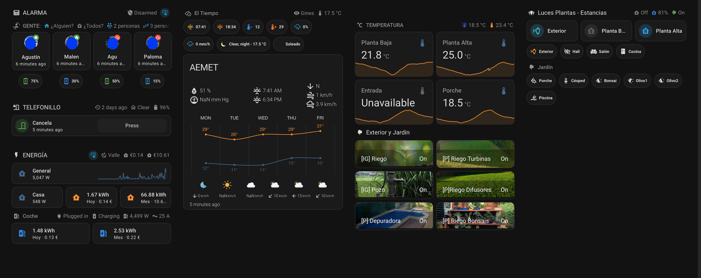
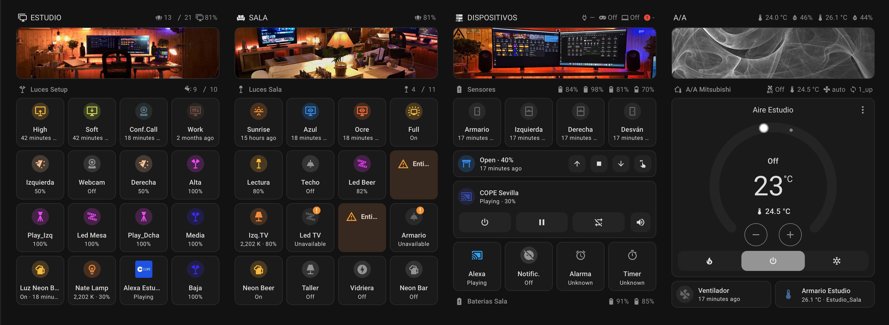
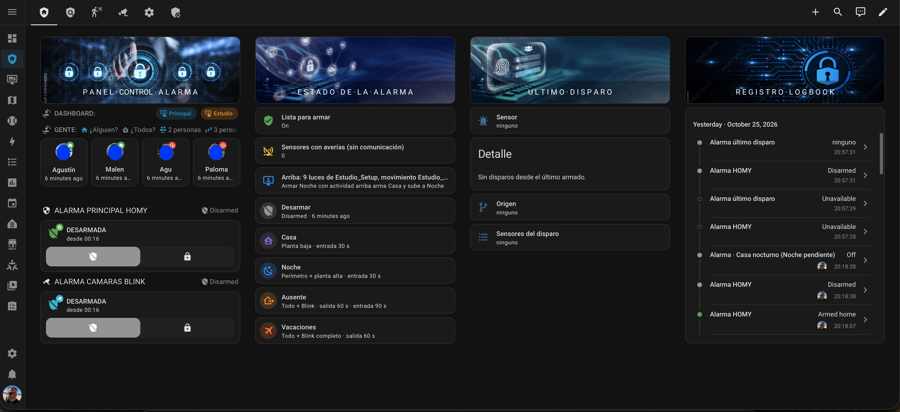

# HOMY — Configuración de Home Assistant

Instalación doméstica de domótica personal gestionada con **Home Assistant**, con la configuración versionada en este repositorio (*configuration as code*). Automatiza climatización, iluminación, seguridad, energía y electrodomésticos de una vivienda unifamiliar, con integración de más de 100 dispositivos entre Zigbee, Matter/Thread y WiFi.

## Arquitectura

| Capa | Tecnología |
|---|---|
| Núcleo | Home Assistant OS en **Home Assistant Yellow** (4 GB RAM, almacenamiento SSD externo), conexión por Ethernet |
| Zigbee | Radio integrada del Yellow, **ZHA** — más de 70 dispositivos |
| Thread / Matter | Antena **HA Connect ZBT-2** como Open Thread Border Router, red Matter-over-Thread en crecimiento |
| WiFi (microcontroladores) | ~30 dispositivos **ESPHome** (ESP32 / Sonoff reflasheados), IP fija por dispositivo |
| Histórico | **MariaDB** como recorder, con estadísticas nativas a largo plazo (medias/min/max horarias) |
| Acceso remoto | **Home Assistant Cloud (Nabu Casa)** |
| Red | Access Points dedicados con SSID independiente para domótica (2.4 GHz) y para usuarios (5 GHz) |

## Estructura del repositorio

```
configuration.yaml          # raíz y ficheros incluidos (automations, scripts, template, sensor…)
packages/                   # funcionalidades autocontenidas (alarma, energía, lavadora, baterías…)
custom_templates/           # macros Jinja reutilizables
esphome/                    # configuración de cada dispositivo ESPHome
dashboard_*.yaml            # dashboards Lovelace en modo YAML
blueprints/                 # blueprints de automatización
```

`secrets.yaml` y los datos personales (IPs, tokens, URLs de acceso remoto) se mantienen fuera de control de versiones.

## Funcionalidades principales

### 🔐 Sistema de alarma propio
Motor de alarma (`alarm_homy`) construido desde cero sobre Home Assistant en lugar de depender de una integración de terceros: zonas Casa / Noche / Ausente / Vacaciones, bloqueo de armado si hay puertas o ventanas abiertas, lector de tag RFID como teclado físico, registro (logbook) de eventos, panel de control dedicado y aviso ante fallos de comunicación de sensores. Integra además el estado de un sistema de cámaras independiente.

### ⚡ Gestión energética
Monitorización de consumo general y por circuito, cálculo de coste según tarifa eléctrica con discriminación horaria (punta / llano / valle), seguimiento de la carga del vehículo eléctrico y paneles de energía diaria/mensual.

### 🧺 Automatización de electrodomésticos
Detección automática de fin de ciclo de lavado mediante consumo eléctrico, con aviso al terminar.

### 🌦️ Riego inteligente
Estación meteorológica propia combinada con la previsión oficial de AEMET para decidir cuándo regar cada zona del jardín.

### 🔋 Gestión de baterías
Inventario y seguimiento de nivel de batería de todos los sensores Zigbee/Matter, con aviso de reposición.

### 🚘 Vehículo eléctrico
Integración del cargador doméstico con el panel de energía (potencia de carga, energía entregada, coste).

### 🏠 Presencia y climatización
Seguimiento de presencia por dispositivo móvil, control de climatización por zonas y escenas de iluminación.

## Dashboards

Interfaz Lovelace completamente personalizada, organizada por vistas:

- **Overview**: estado general de la casa de un vistazo — alarma, presencia, clima exterior (AEMET), temperaturas por planta, energía en tiempo real y control de iluminación por zonas.
- **Vistas por estancia** (p. ej. Estudio): control detallado de luces, sensores, climatización y multimedia de cada habitación.
- **Panel de alarma**: control de armado/desarmado, estado de sensores, último disparo y registro histórico de eventos.

<p align="center">
  <br>
  <em>Dashboard Overview General</em>
</p>

<p align="center">
  <br>
  <em>Dashboard Estudio</em>
</p>

<p align="center">
  <br>
  <em>Dashboard Alarma</em>
</p>

## Flujo de trabajo

El desarrollo sigue un flujo de *GitOps* ligero: los cambios se preparan y versionan en este repositorio, se validan y se despliegan a Home Assistant, nunca se edita directamente en el editor visual salvo para los dashboards. El backlog de mejoras y tareas pendientes se gestiona como **GitHub Issues** en este mismo repositorio, organizado por subsistema.

## Estado del proyecto

En desarrollo activo y uso diario de producción. Próximos frentes: migración completa del parque ESPHome a firmware reciente, ampliación de la red Matter/Thread y un modelo espacial (plano de la vivienda) integrado en el dashboard.

---

*Repositorio de uso personal. La configuración incluye referencias a hardware y servicios de terceros propios de esta instalación; no está pensado como plantilla genérica, aunque partes del código pueden servir de referencia.*
